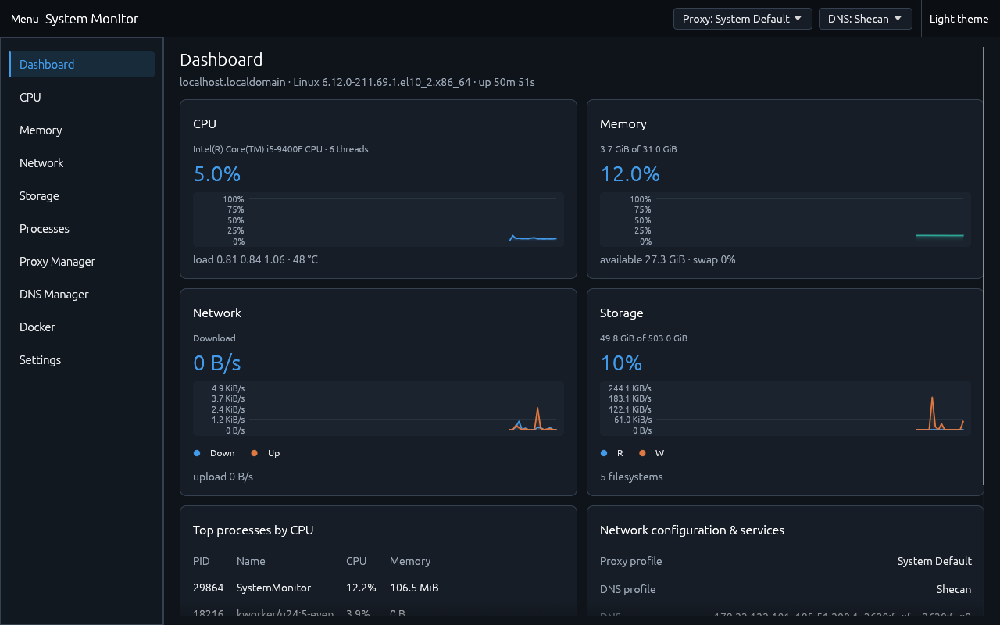
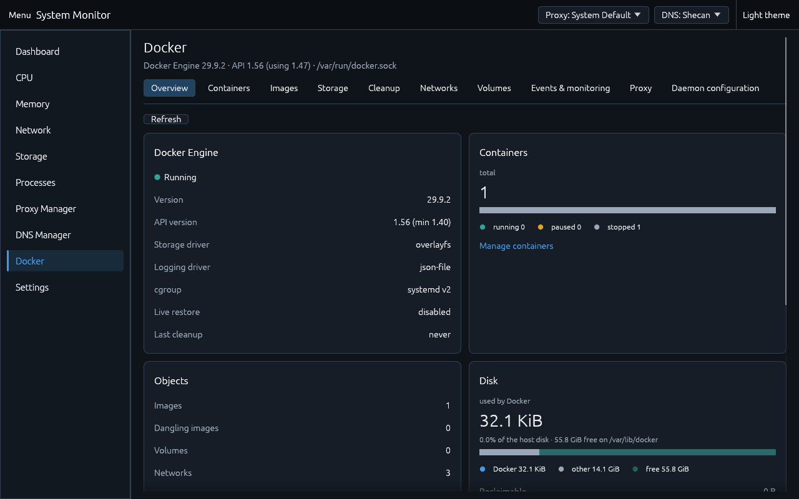

# System Monitor

Linux system monitor, network manager and Docker administration tool (Rust, egui/eframe, Cloudscape-inspired UI), plus a text-mode CLI.
Runs as your user; never as root. Administrative steps go through PolicyKit (`pkexec`) and are always user-initiated.

    ./SystemMonitor                 # GUI, Dashboard
    ./SystemMonitor --page proxy    # dashboard cpu memory network storage processes proxy dns docker settings
    ./SystemMonitor --install       # add to the application menu; --uninstall removes it
    ./SystemMonitor --gfx software  # graphics backend: auto | hardware | software | headless
    ./SystemMonitor --cli [cmd]     # text mode, works without a display (see below)

## Build flavors

| Command | Result | Linking | GUI | Runs on |
|---|---|---|---|---|
| `./build.sh glibc` | `dist/SystemMonitor` | dynamic glibc | yes | glibc distros (see "glibc version") |
| `./build.sh glibc-compat` | `dist/SystemMonitor-glibc-compat` | dynamic glibc, built in Debian 11 | yes | older glibc distros |
| `./build.sh musl` | `dist/SystemMonitor-musl` | dynamic musl | yes | Alpine / Void-musl (needs Mesa, Wayland/X11 libs from the distro) |
| `./build.sh core` | `dist/SystemMonitor-core-static` | **fully static** musl | **no** (CLI only) | any Linux of the same CPU architecture, no libraries needed |
| `./build.sh test` | | | | unit tests for GUI and core builds |

`./build.sh all` builds everything possible on the current machine. Requirements: Rust stable (rustup) and a C
linker; `glibc-compat` and `musl` also need `podman` or `docker` unless the host already is that libc.
Cargo features: `gui` (default). `cargo build --no-default-features` builds the core only.

### Static linking: what is and is not possible

* **Core/CLI: fully static musl works.** `dist/SystemMonitor-core-static` is a static-PIE executable
  (~1.6 MB) with zero shared-library dependencies. It reads `/proc`/`/sys`, talks to NetworkManager,
  systemd-resolved, the Secret Service and polkit over D-Bus (pure-Rust zbus), runs `smartctl`/`gsettings`/`systemctl`
  as external programs, and provides all `--cli` commands.
* **GUI: a static GUI is not possible, and none is offered.** An OpenGL window needs the machine's own
  graphics driver stack (Mesa/vendor `libEGL`, `libGL`, DRI/gallium drivers) plus `libwayland-client` /
  `libX11` / `libxkbcommon`. These are loaded at run time with `dlopen`, and the drivers are tied to the host's libc.
  A static musl program cannot `dlopen` at all. This was checked rather than assumed: a static-musl build *with*
  the GUI links and starts, then every window system fails with "The wayland library could not be loaded" /
  "Failed to load one of xlib's shared libraries". The program detects a static-musl GUI build up front, explains
  this, and falls back to the text report instead of retrying.
* The GUI libraries are **not** linked at build time, so no `-dev` packages are needed to build, and one
  GUI binary works across distributions as long as the libc matches. The only hard dependencies are the libc
  family: `libc`, `libm`, `libgcc_s` (glibc build) or `libc.musl` (musl build).

### Dependencies that prevent static GUI linking

| Dependency | Why |
|---|---|
| `libEGL` / `libGL` / `libGLX` + Mesa DRI/gallium drivers | `dlopen`ed (glutin); driver choice is machine specific |
| `libwayland-client`, `libwayland-egl` | `dlopen`ed (winit, `wayland-dlopen`) |
| `libX11`, `libxcb`, `libXcursor`, `libXi`, `libxkbcommon(-x11)` | `dlopen`ed (winit, `x11-dl`) |
| static `dlopen` | not implemented by musl (and unsupported on glibc without a matching `libc.so`) |

Everything else (zbus, tokio, serde, `libc`) is pure Rust or libc and links statically without trouble.

### glibc version

The GUI build only needs the libc version it was linked against. Built on AlmaLinux 10 (glibc 2.39) it required
**glibc ≥ 2.39**, mostly because the Rust standard library references `pidfd_spawnp` (2.39) and several symbols
that moved in 2.34/2.35 (`pthread_*`, `dlopen`, `hypot`).
Built in a Debian 11 container (glibc 2.31) by `./build.sh glibc-compat`, the same source needs only **glibc ≥ 2.30** (highest symbol version found with `objdump -T`: `GLIBC_2.30`), so Ubuntu 20.04+, Debian 11+, RHEL/Alma 8+ and Mint 20+ are covered. The default `./build.sh glibc` keeps the host's glibc requirement.

## Text mode (`--cli`) and headless use

    SystemMonitor --cli                 # status: CPU / memory / network / disks
    SystemMonitor --cli json            # same as JSON
    SystemMonitor --cli services        # NetworkManager, systemd-resolved, Secret Service, polkit, gsettings, smartctl
    SystemMonitor --cli gfx             # graphics diagnostics and install hints
    SystemMonitor --cli smart [sda]     # disk health, read-only
    SystemMonitor --cli dns             # resolver stack, conflicts, persistent or runtime-only
    SystemMonitor --cli proxy           # GNOME probe, session proxy, shell hooks
    SystemMonitor --cli proxy-env bash  # script to bring an open terminal up to date
    SystemMonitor --cli shell-setup status|install|remove [bash] [zsh] [fish]
    SystemMonitor --cli docker [status|df|containers|images|preview [-a] [--volumes]|events|audit]   # read-only

With no display (no `WAYLAND_DISPLAY`/`DISPLAY`) or `--gfx headless`, the GUI binary prints this status report
instead of failing. In a build without the GUI, text mode is the only mode.

## Graphics: GPUs, VMs, remote desktops

At start the program inspects (without loading any graphics library) the session type, `/sys/class/drm`
GPUs and their drivers (virtio, vmwgfx, QXL, Bochs, VirtualBox, Hyper-V and firmware framebuffers are recognized as
virtual), DRM render nodes, the hypervisor, `libEGL`/`libGL`, Mesa DRI/gallium drivers, LLVM (llvmpipe), and
the Wayland/X11/xkbcommon libraries. It then plans stages:

1. **hardware OpenGL**, skipped when the machine has no GPU or only virtual ones and a Mesa software renderer exists;
2. **Mesa software renderer** (`LIBGL_ALWAYS_SOFTWARE=1`, `GALLIUM_DRIVER=llvmpipe`, or `softpipe` if llvmpipe is missing);
3. **software renderer through X11** (only on a Wayland session that also has `DISPLAY`).

A failed stage restarts the program with the next stage's environment (Mesa fixes its driver per process).
Errors *and panics* during window creation are caught. If every stage fails the program prints what it found,
what is missing, and the exact package command for your distribution, for example
`sudo dnf install mesa-libEGL mesa-libGL mesa-dri-drivers` (Fedora/RHEL/Alma),
`sudo apt install libegl1 libgl1 libgl1-mesa-dri libglx-mesa0 libegl-mesa0` (Debian/Ubuntu),
`sudo pacman -S mesa libglvnd` (Arch), `sudo apk add mesa-egl mesa-gl mesa-dri-gallium` (Alpine),
then shows the text report and exits with status 3. It never aborts with a bare driver error.

Selection, highest priority first: `--gfx <mode>`, `SYSMON_GFX`, Settings → Graphics (`settings.json`), `auto`.
Modes: `auto`, `hardware` (no fallback), `software`, `headless`. Settings → Graphics shows the active
renderer string (for example `llvmpipe (LLVM 21.1.8, 256 bits)`) and warns when software rendering is in use.
Raise the refresh interval on software rendering if the UI feels slow.
Limits: a driver that crashes the process (segfault) rather than returning an error cannot be recovered from
in-process; use `--gfx software` for such machines. `SYSMON_GFX_TEST_FAIL=<n>` makes the first *n* stages fail,
to test the fallback.

## Proxy manager

Scopes are kept separate and shown separately: process environment, GNOME/GTK (gsettings), KDE (`kioslaverc`, KIO
notified over D-Bus), user session (`~/.config/environment.d` + `systemctl --user set-environment`),
system-wide (`/etc/environment` through the `pkexec` helper), and application configs (git, npm, curl, wget, apt,
dnf, docker: detected, never modified). HTTP/HTTPS/SOCKS4/SOCKS5, bypass list, profiles, built-in *Direct
Connection* and *System Default*, automatic backup before every change, restore.

### GNOME (gsettings/dconf)

* Detection: GNOME-family `XDG_CURRENT_DESKTOP`/`XDG_SESSION_DESKTOP`, `gsettings` binary, schema
  `org.gnome.system.proxy` (`gsettings-desktop-schemas`), the dconf GIO module, and `GSETTINGS_BACKEND`.
  `SystemMonitor --cli proxy` prints the probe.
* Every key is written, then **read back in a separate process** (a throw-away memory backend cannot fake that).
  On any mismatch or failure all keys are restored to their previous values and the apply is reported as failed.
  Success is only reported after verification.
* Passwords are **never written to dconf** (it stores plain text; the schema even has an
  `authentication-password` key which is left untouched). Only the user name is set. The password lives in the Secret
  Service (GNOME Keyring / KWallet / KeePassXC) when one is available; GNOME has no standard keyring field for proxy
  passwords, so GNOME applications ask for it. Without a Secret Service the password is kept in memory for the session
  only and not saved; the UI says so instead of downgrading silently.

### Propagation to shells and applications

Environment variables are copied into a process when it starts. A shell that is already running keeps its own
copy and no program can change another process's environment, so **already-open terminals never update by
themselves**. New processes inherit from their parent: graphical launches from the login session
(`environment.d`, `/etc/environment`, `systemctl --user set-environment`), terminals from the shell start-up files.

* Per-user: `environment.d` file (mode 0644, or 0600 if credentials are embedded on request).
* Per-system: `/etc/environment` block, applied after the next login.
* Desktop session: gsettings / KDE settings (apps that read desktop settings pick it up when they start).
* The running application: `shellenv::set_process_proxy` updates the variables handed to programs this app starts, immediately.
* New terminals: `SystemMonitor --cli shell-setup install` adds **one delimited block** to `~/.bashrc` / `~/.zshrc`
  (`$ZDOTDIR` honored) and a dedicated `~/.config/fish/conf.d/systemmonitor-proxy.fish` (fish's `config.fish` is never
  touched). The block sources `~/.config/SystemMonitor/proxy.env` (bash/zsh) or `proxy.fish`. It is added once
  (re-running never duplicates it, and hand-made duplicates collapse to one), symlinked dotfiles stay symlinks, a backup is taken first
  (`~/.config/SystemMonitor/backups/shell/`), the result is syntax-checked with the shell and verified, and
  anything outside the block is left byte for byte. `shell-setup remove` deletes only the block.
* Disabling the proxy removes the env files and unsets the session variables; new shells then export nothing.
  The few-line hook stays (it is inert) until you run `shell-setup remove`.
* **Existing terminals:** run `eval "$(SystemMonitor --cli proxy-env bash)"` (zsh: same; fish:
  `SystemMonitor --cli proxy-env fish | source`). It exports the current proxy, or unsets the variables if the proxy is disabled.

## Docker management

The **Docker** page (`--page docker`) manages the local Docker Engine without a terminal. It has these tabs:

| Tab | What it does |
|---|---|
| Overview | Engine status, version and API version, storage/logging driver, container states (running/paused/stopped/unhealthy), image/volume/network counts, Docker disk usage against the host disk, reclaimable space, last cleanup, live CPU/memory charts, busiest containers |
| Containers | Search, state filter, sortable table (name, ID, image, state + health, uptime, ports, created, CPU, memory). Start, stop, restart, pause, unpause, remove, force remove (confirmed). Details: summary/health log, environment (secret-looking values hidden by default), ports, mounts, networks, CPU/memory/network/disk I/O charts, live logs (follow, tail, timestamps, filter), an interactive terminal (`exec` with a TTY), full inspect JSON |
| Images | Pull with progress, search, filters (in use / unused / dangling / older versions), size, created, which containers use each image, duplicate tags, untag/remove (images used by containers are refused), layers (history) and inspect |
| Storage | `/system/df` analysis: images, container writable layers, volumes, build cache, reclaimable space per type, share of the host disk, unused and orphaned objects, per-object tables sortable by size |
| Cleanup | Separate actions or `system prune` / `prune -a` / `prune --volumes` presets. Always shows a **preview** (every object, its size, warnings, and what is kept and why) and an estimate before anything is deleted; then a confirmation; then per-item results, space recovered and host free space before/after |
| Networks | List with driver, scope, subnet, gateway, attached containers; create (bridge/macvlan/ipvlan/overlay, subnet/gateway validated), remove, connect/disconnect containers, inspect |
| Volumes | Name, driver, mountpoint, size (when the driver can measure it), users, unused filter; create, inspect, remove (refused while used; typing the name is required when the volume may hold data) |
| Events & monitoring | Live engine event stream (the last hour is replayed at start), filters by type, action and container, pause; CPU/memory of all containers over time |
| Proxy | `HTTP_PROXY`, `HTTPS_PROXY`, `ALL_PROXY`, `NO_PROXY` with HTTP/HTTPS/SOCKS5 and authentication, for the **daemon** (`daemon.json` `proxies`: pulls, pushes, registry access) and/or **containers and builds** (`~/.docker/config.json` `proxies.default`). Shows the current values (passwords masked) and what the daemon reports as in effect, warns about conflicting systemd drop-ins, **tests connectivity** through the proxy (HTTP CONNECT or SOCKS5 handshake incl. credentials) before applying |
| Daemon configuration | `daemon.json` editor plus form fields (registry mirrors, insecure registries, DNS, log driver and rotation, live-restore, data-root, storage driver); live validation on every keystroke, `dockerd --validate`, backup before every save, backups list and restore, guarded daemon restart |

### Installation and requirements

* Docker Engine 20.10 or newer (API ≥ 1.41) on the same machine; tested with Docker 29.9 (API 1.56; the client speaks
  API 1.47 and negotiates down for older daemons). Socket: `DOCKER_HOST=unix://…`, else `/var/run/docker.sock`, else the
  rootless `$XDG_RUNTIME_DIR/docker.sock`. TCP `DOCKER_HOST` endpoints are not supported (they would need TLS client certificates).
* Your user needs access to the Docker socket: `sudo usermod -aG docker $USER`, then log out and in. The app does not
  do this for you (see Security).
* Changing `daemon.json` and restarting the daemon needs PolicyKit (`pkexec`) and an administrator password, like the
  system-wide proxy. `dockerd` on the machine enables `dockerd --validate` checks (optional).
* No extra libraries: the Engine API client is plain Rust over the Unix socket (no new crates).

### Configuration notes

* **Daemon proxy vs. container proxy.** The daemon uses its proxy for image pulls/pushes and registry logins; it supports
  HTTP_PROXY, HTTPS_PROXY and NO_PROXY (not ALL_PROXY; the UI says so and leaves it out). The client file sets the variables
  the `docker` CLI injects into **new** containers and builds, including ALL_PROXY; no restart is needed.
* **A daemon restart is required** after any `daemon.json` change (proxy or other settings): the daemon reads the file only at start.
  The UI shows a "Restart required" banner and explains the impact before restarting: without `live-restore`, running containers
  stop; those with a restart policy come back.
* **Merging, never overwriting.** Every change re-reads the current file and changes only its own keys (`proxies`, or the form fields);
  every other key is kept (key order is normalized). In `~/.docker/config.json` only `proxies.default` changes; `auths`,
  `credsStore` and other entries are preserved. Backups: `~/.config/SystemMonitor/backups/docker/` (0600) before each save,
  plus a root-only `daemon.json.systemmonitor-<time>.bak` next to the file (last 10 kept).
* Proxy passwords have to live inside these files (Docker has no keyring). `daemon.json` is then written `0600`. Passwords are never shown
  (masked in the UI, replaced by a placeholder in the editor and put back on save) and never logged.

### Security

* The frontend never sees the socket: this is a desktop app and every Engine API call runs in-process on a worker thread.
  No `docker` CLI is run and no terminal output is parsed; structured JSON from the Engine API only.
* **Who may use it.** Access to the Docker socket is Docker's own administrator boundary (root or the `docker` group, which is
  root-equivalent). Without it the page explains why and changes nothing; it never escalates. Host-level changes (`daemon.json`,
  restart) additionally require PolicyKit administrator authentication and run in a separate helper process
  (`SystemMonitor --helper-docker write <staged>|restart`) that re-validates the staged file (regular file, owned by the caller,
  ≤ 256 KiB, JSON object, all checks below), writes atomically and runs a fixed `systemctl restart docker.service` argv.
* **Input validation.** Container/volume/network names and IDs follow Docker's own grammar; image references are parsed
  (registry, path, tag, digest); everything placed in a URL is percent-encoded; exec commands are passed as an argv array
  (no shell). `daemon.json` checks: types of known keys, URLs of mirrors, registry host/CIDR, DNS IPs, log options as strings
  (a number there stops dockerd from starting), proxy URLs; `"hosts"` with `tcp://` and no `tlsverify` is **refused** (it would
  hand root to the network).
* **Destructive operations** need a confirmation; force-removing a running container and deleting volumes that may hold data need
  the name / `DELETE VOLUMES` typed. Cleanup deletes exactly the previewed objects one by one **without force**, so anything that
  started being used in the meantime is refused by Docker. Running/paused containers, images of kept containers and mounted
  volumes are never selected; removing a container never removes its volumes; named volumes are only included on explicit request.
* **Audit log.** Every change (lifecycle actions, removals, pulls, exec sessions, network/volume changes, cleanup items, proxy and
  daemon changes, restarts) is appended to `~/.config/SystemMonitor/docker-audit.log` (JSON lines, 0600, rotated at 1 MiB) with
  time, user, action, object and outcome. Values are never logged and URLs are scrubbed of credentials. `--cli docker audit` prints it.
* Timeouts on every call (15 s by default, longer for stop/restart, `df`, pruning); streams (logs, events, exec) are cancelled when closed.
  Environment variables named like `*PASSWORD*`, `*TOKEN*`, `*KEY*`, `*SECRET*` are hidden until you choose to show them.

Real-time data uses background threads instead of WebSockets/SSE (there is no browser): the engine's `/events` stream drives
automatic list refreshes and the Events tab; container statistics are polled every 2 s, only while a Docker page is visible.

## DNS manager

Profiles: Automatic (DHCP), Cloudflare, Google, Quad9, custom, IPv4 and IPv6. The backend is chosen from what is
running:

| Stack | Mechanism | Persistence |
|---|---|---|
| NetworkManager (default on most desktops) | `Settings.Connection.Update` + `Device.Reapply` over D-Bus | **persistent** (connection profile); the result says whether NM reports the profile as unsaved |
| systemd-resolved (+ networkd or nothing else) | `SetLinkDNS`, `SetLinkDefaultRoute`, `RevertLink` over D-Bus; the link's `DNS` property is read back | **runtime only** (lost when the link or resolved restarts) |
| neither | none | unsupported; the UI/CLI explain why |

Persistent DNS for resolved-only systems needs an administrator to add `DNS=` to the interface's
`/etc/systemd/network/*.network` or a `/etc/systemd/resolved.conf.d/*.conf` drop-in; this program does not write
those. `/etc/resolv.conf` is **never** modified (a unit test scans the sources for it).

Environment report (`--cli dns`, and the "Resolver stack" box on the DNS page) detects: resolved installed/running,
NetworkManager and its `dns=` mode, systemd-networkd, the `resolv.conf` layout (stub, uplink, NM, static file), and
conflicts: NM + networkd both managing links, resolved running while `resolv.conf` bypasses it, stub in `resolv.conf`
with resolved stopped, NM `dns=default` next to a running resolved, `dns=systemd-resolved` without resolved, `dns=none`.

Every change is backed up first; the new servers must answer a test query, resolved must report the servers on the link,
NetworkManager must list them as in use (otherwise the connection is re-activated), and resolver caches are flushed.
Any failure restores the backup of every connection that was touched. Browsers keep their own DNS cache.

Supported/expected: Fedora, RHEL/Alma/Rocky 9+, Ubuntu 22.04+, Debian 12+ (NetworkManager or resolved), Arch,
openSUSE. Tested here: NetworkManager on AlmaLinux 10.

## Disk health (SMART)

`smartctl` (smartmontools) is run with read-only options only (`-j -i -H -A -c -l error`, optional `-d`);
a unit test rejects any argument that could change the drive (`-s`, `-t`, `-X`, `-C`, `--set`, ...).
It runs as the user first; "Check (admin)" uses `pkexec` only when you press it.
SATA (`sd*`), NVMe (`nvme*`) and USB bridges (tries `-d sat`, `sat,12`, `scsi` after a plain attempt reports an unknown bridge)
are handled. Shown: health verdict, temperature, power-on hours, NVMe percentage used and spare, SSD wear attribute
(177/231/233), reallocated/pending/uncorrectable sectors, CRC and media errors, unsafe shutdowns, error-log notes.

**Unavailable is not failing**: "needs permission", "no SMART data / unsupported bridge", "not installed" and "virtual
device" are separate states shown in grey. A disk is shown as failing only when the drive says so
(`smart_status.passed == false` or smartctl exit bit 3). Counters produce warnings, not failures.
"Refresh all" re-reads every device.
Compatibility: tested against mocked smartctl 7.x JSON for healthy/failing/warning SATA, NVMe, permission denied,
USB-unknown-bridge and no-SMART cases, and against the real `smartctl 7.4` on this machine (NVMe, non-root → correctly
reported as "needs permission", not as a failure). Not tested on real failing hardware, real USB bridges or SAS/RAID controllers
(smartctl's `-d megaraid,N` etc. are not attempted). Virtual disks, eMMC and most USB flash drives have no SMART.

## Persistence

`~/.config/SystemMonitor` (0700) holds `settings.json`, `proxy-profiles.json`, `dns-profiles.json` and `backups/`.
JSON stays the format (no SQLite: a few small documents, no measurable benefit, and no C dependency for the static core).
Writes are atomic (temp file → `fsync` → `rename` → directory `fsync`), files are 0600, writers are serialized by
`flock`. Every file has `schema_version`; older files are migrated step by step after a copy is saved in
`backups/migrations/` (e.g. `dns-profiles.json` was a bare array, now an object). A newer-than-known file is never
overwritten. Unparsable files are moved to `*.corrupt-<time>` and the last good `*.bak` is restored; fields that still
parse are salvaged one by one, bad list entries are dropped, out-of-range values are clamped, loose permissions
are tightened. Passwords are never stored here.

## Concurrency

See [docs/ARCHITECTURE.md](docs/ARCHITECTURE.md): Tokio is kept (one runtime thread, only to drive zbus); blocking
work runs on plain worker threads; the sampler publishes immutable snapshots and is cancelled and joined on exit.

## Runtime dependency report

Hard dependencies: libc family only (see above). Loaded at run time by the GUI: `libEGL`/`libGL` (Mesa or vendor),
`libwayland-client`/`libwayland-egl`/`libxkbcommon` (Wayland) or `libX11`/`libxcb`/`libXcursor`/`libXi` (X11).
Optional services, detected and disabled gracefully: NetworkManager, systemd-resolved, Secret Service, polkit/`pkexec`,
`gsettings`/dconf, `smartctl`, `systemctl --user`. Fonts, UI and charts are embedded.

## Verification performed

Machine: AlmaLinux 10.2, KDE Plasma (Wayland + XWayland), NetworkManager, no systemd-resolved, Mesa llvmpipe available.

* `cargo test`: 62 tests (+5 live tests, run on demand) with GUI and with `--no-default-features` (graphics planning, persistence recovery/migration/concurrency,
  SMART parsing with mocked output and a fake `smartctl`, shell hooks, DNS stack classification, GNOME apply/rollback with a fake `gsettings`, privileged-helper validation, sampler shutdown;
  Docker: HTTP/chunked/multiplexed-stream parsing, error classification incl. permission denied, input validation before any request, a fake
  Engine on a Unix socket, cleanup planning and execution safety (running containers, used images, volume confirmation, order, audit), disk usage
  totals, stats/CPU maths, daemon.json validation and merge, client config merge, proxy URL parsing/masking, proxy connectivity against fake
  HTTP-CONNECT and SOCKS5 proxies, the privileged daemon.json helper, editor secret masking, ANSI stripping).
* Docker live test (`cargo test -- --ignored live_docker`) against Docker 29.9.2 here: inventory, `df`, container create/start/logs/remove,
  network create/connect/disconnect/remove, volume create/inspect/remove, image history. `--cli docker` commands ran against it, and every
  Docker tab was rendered in the GUI. Not exercised live: `daemon.json` write and daemon restart through the real `pkexec` dialog
  (the helper is tested unprivileged against a temporary directory), a real upstream proxy, swarm/overlay networks, rootless Docker.
* Static musl core: built, `file` = static-PIE, `ldd` = not dynamic, all `--cli` commands run including D-Bus detection.
* Static musl **GUI**: built and started to confirm it cannot open a window (see above); the fallback printed the diagnostics
  and the text report without crashing.
* Graphics fallback, GUI build: forced stage-1 failure (`SYSMON_GFX_TEST_FAIL=1`) → restarted on Mesa llvmpipe →
  window rendered (screenshot taken); `--gfx software` likewise (via XWayland; the compositor here does not deliver
  frames for the automated screenshot on native Wayland).
* GNOME proxy persistence: live apply → read back → restore against the real gsettings/dconf service; settings identical afterwards.
  **This is a KDE session with dconf, not a GNOME Shell session.**
* NetworkManager DNS and Secret Service live tests from earlier work (apply, verify, restore).
* Dynamic **musl GUI** (`rust:alpine` container, Alpine's Mesa + Xvfb): built, linked against `libc.musl`, `--cli gfx` and the GUI
  ran, the window rendered through llvmpipe and a screenshot was written. A first run without `libxkbcommon-x11` failed and
  fell back to the text report; the diagnostics now name that package.
* glibc-compat build in a Debian 11 container: requires glibc ≥ 2.30 (host build: 2.39); it starts and runs `--cli` here.

## Known limitations

* No static GUI (above). A static-musl GUI build links but refuses to open a window.
* **Not tested here:** systemd-resolved (not running on this machine; the D-Bus code is written to the documented API and
  its decisions are unit-tested, but it has not been exercised against a live resolved), a real GNOME Shell session, the
  real `pkexec` authentication dialog, real failing disks and USB bridges, Ubuntu/Debian/Fedora/Arch/Mint/Alpine desktops
  (except as noted), Fish/Zsh (hook logic is tested with temporary dotfiles; syntax check runs only if the shell is installed).
* Graphics: a driver crash (not an error) kills the process; use `--gfx software`.
* Open terminals never inherit proxy changes by themselves (see above).
* Persistent DNS on resolved-only systems is not written by this program (explained in the UI/CLI).
* GNOME proxy passwords are not stored in dconf by design.
* Default egui fonts only (no CJK/RTL coverage); icons are text-only. This also means **no Persian / right-to-left UI**: egui
  has no bidirectional text layout and the embedded fonts have no Arabic-script glyphs, so the Docker page is English-only.
* Docker: only the local Unix socket (no remote/TCP hosts, no swarm services/stacks management); private-registry pulls need a prior
  `docker login`; HTTPS proxies (TLS to the proxy) are tested for TCP reachability only.

## License

MIT License, Copyright (c) 2026 mtafakori1993. You may use and modify this freely, but you must keep the copyright notice (credit) in copies. See [LICENSE](LICENSE).
